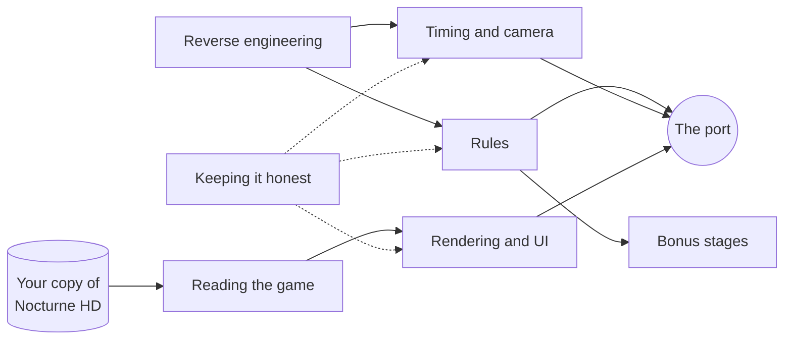

# How Puzzle Boy was rebuilt

> [!TIP]
> **TL;DR:** Puzzle Boy is a minigame inside *Shin Megami Tensei III Nocturne HD Remaster*. This repo rebuilds it as a game of its own, in C# with MonoGame, without shipping a single byte of the original. These pages explain what went into it, one topic per page, each a few minutes long.

## Start here

- **Just curious?** Read [The journey](journey.md). It's the whole story in order, fun parts included.
- **Changing the code?** Read [Architecture](architecture.md), then the page for the area you're touching.
- **Into reverse engineering?** Read [Reverse engineering](reverse-engineering.md), then [Bonus stages](bonus-stages.md).

## The pages

| Page | What it answers | Read time |
|---|---|---|
| [The journey](journey.md) | What happened, in what order, and what surprised us | 5 min |
| [Architecture](architecture.md) | How the code is laid out, and what one tick does | 4 min |
| [Reverse engineering](reverse-engineering.md) | How the rules came out of the game without crossing the line | 5 min |
| [Rules](rules.md) | Stage files, cells, steps, pushes, swivels and undo | 5 min |
| [Timing and camera](timing-and-camera.md) | Ticks, move lengths, input order and the camera | 4 min |
| [Reading the game](reading-the-game.md) | Bundles, textures, sound, Jack's model and the text | 5 min |
| [Rendering and UI](rendering-and-ui.md) | The board's look, Jack, the HUD and a font drawn on the CPU | 5 min |
| [Bonus stages](bonus-stages.md) | The 30 stages the original never plays, and the switch. History: they're Community Edition's now | 4 min |
| [Keeping it honest](keeping-it-honest.md) | Tests, replays, footage checks, CI and the guardrails | 4 min |

## How the pages connect

## Three rules that shaped everything

1. **Bring your own copy.** No stages, text, audio, textures, models or decompiled code live here. The game reads them from your install when it starts.
2. **Unprotected code only.** The game's code is protected by Denuvo Anti-Tamper. We statically read the parts that aren't protected, and nothing else.
3. **Tests before code.** Every rule found in the game became a test on a handmade stage before it became code.

Decisions and their evidence are logged in [ROADMAP.md](../ROADMAP.md). The working rules for agents are in [AGENTS.md](../AGENTS.md).
