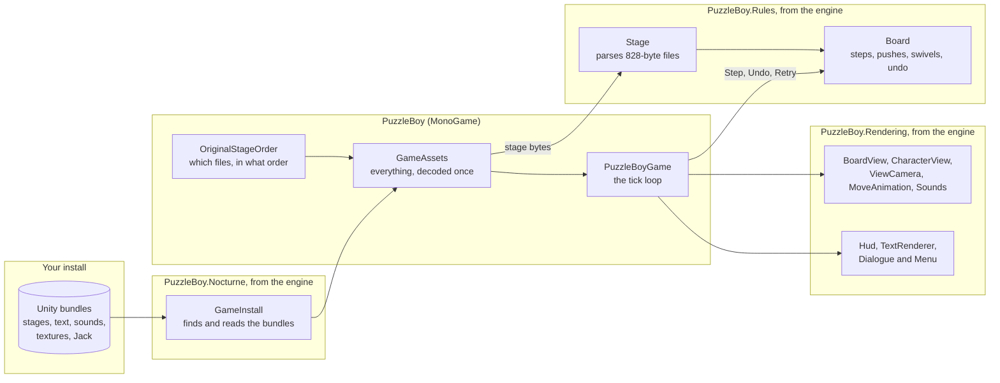
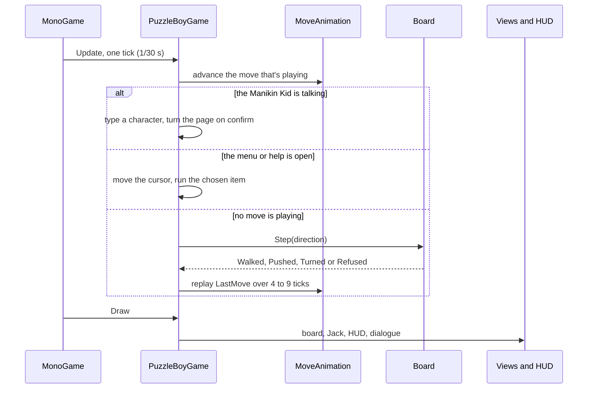

# Architecture

> [!TIP]
> **TL;DR:** There are two projects, plus the engine. The engine, [puzzle-boy-engine](https://github.com/hazeliscoding/puzzle-boy-engine), is a git submodule in `external/puzzle-boy-engine` that Community Edition shares. Its `PuzzleBoy.Rules` holds the game's logic, with no graphics and no file access, so tests drive it with plain bytes. Its `PuzzleBoy.Nocturne` reads your install's bundles, and its `PuzzleBoy.Rendering` draws the board, Jack, the HUD, dialogue and menu and plays the sounds. `PuzzleBoy` is the MonoGame app: it reads everything from your install once at startup, then runs the original's 30-tick loop and decides what shows when.

**Read time:** 4 minutes

## The big picture

## The trick that keeps it simple

**The rules are instant, and time belongs to the game.**

- `Board.Step` applies a whole move at once and records what moved in `LastMove`.
- `MoveAnimation` then replays that move over 4 ticks for a walk, 5 for a push or turn, or 9 for a fall. It also tells the game when the fall and goal sounds play.
- So the rules are tested without a clock, and the timing is checked against footage without touching the rules.

## One tick

The game runs MonoGame at a fixed 30 updates a second, and each update is one of the original's ticks.

## Who does what

| Type | Job |
|---|---|
| `Stage` | Parses a stage file, repairing the six damaged ones |
| `Board` | The rules: steps, pushes, falls, swivels, the goal, undo and retry. Its switch is Community Edition's; this port never calls it |
| `OriginalStageOrder` | The original's 20 stage files, in its order |
| `GameInstall` | Finds the Steam install and reads bundles with AssetsTools.NET (engine, `PuzzleBoy.Nocturne`) |
| `GameAssets` | Reads and decodes every asset once at startup, in about 2 seconds |
| `PuzzleBoyGame` | The tick loop: input, menus, dialogue, stage flow |
| `ViewCamera` | The follow camera, view turns, the overhead view and the quake (engine, `PuzzleBoy.Rendering`, like the next five and `Sounds`) |
| `MoveAnimation` | Replays one move over its ticks |
| `BoardView` | Board geometry, glass walls, outlines, the goal and the backdrop |
| `CharacterModel`, `CharacterView` | Pose and skin Jack each tick, then draw him with his shadow and glow |
| `Hud`, `TextRenderer` | The stage counter, banners, controls bar, menu, help and dialogue, plus the CPU font |
| `Dialogue`, `Menu` | Dialogue typing and pages, the menu cursor and key repeat |
| `Sounds` | Effects and looping music; silent when there's no audio device |

## Design choices

- **No content pipeline.** Nothing is converted ahead of time, because there's nothing we're allowed to convert. Every asset is read from the install at runtime.
- **CPU decoding everywhere.** DXT1 textures, Vorbis audio, the font and Jack's skinning all run on the CPU, so every OS gets the same pixels and samples.
- **One update is one tick.** `IsFixedTimeStep` with a 1/30 s step keeps the original's pace on any display.
- **Pragmatic, documented code.** The build fails on any public member without an XML doc comment, and shortcuts are marked `shortcut:` with the reason and when to upgrade.

## Where to look

- `src/PuzzleBoy/PuzzleBoyGame.cs`: start at `Update`, then `Play`.
- `external/puzzle-boy-engine/src/PuzzleBoy.Rules/Board.cs`: start at `Step`.
- `external/puzzle-boy-engine/src/PuzzleBoy.Rendering/BoardView.cs`: start at `Draw`.
- `tests/PuzzleBoy.Tests/Ascii.cs`: how tests draw stages as text.
- `tests/PuzzleBoy.Tests/PreservationScopeTests.cs`: the checks that keep this port to the original's 20 stages.
