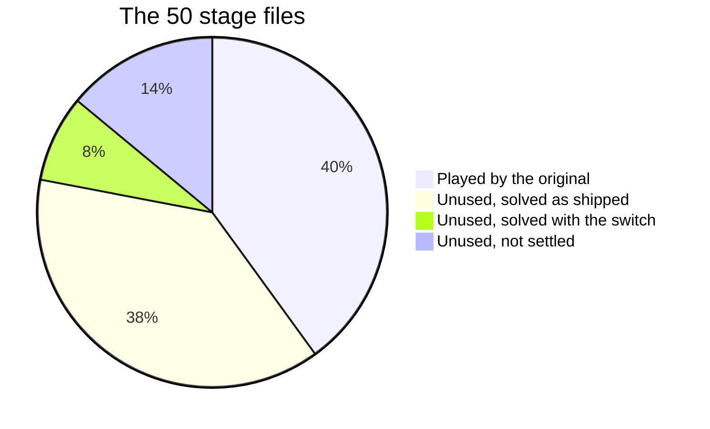

# Bonus stages

> [!TIP]
> **TL;DR:** The game ships 50 stage files and plays 20. In the port, 23 of the other 30 come after stage 20: every one with a solution that clears the port. Six of the seven stages with several Jack-o'-Lanterns can't be finished under the original's rules, because only the first character can move until it reaches the goal. The port adds a switch key, C, and with it four of them can be won.

**Read time:** 4 minutes · **Status:** M4, done · **Code:** `PlayOrder.Bonus`, `Board.Switch`

## The 50 files

- The original's code lists file 00 for "levels 2 and 3", but every video and guide ends after stage 20, so 00 counts as unused here.
- None of the 30 is a duplicate or junk. Every start and goal is on floor, and no goal is walled off. A few are tutorial-sized, at 3 or 4 pushes.
- They include all seven multi-character stages, and the six files damaged by the line-ending conversion.

## How the survey worked

- A local search explored each stage by pushes and turns, treating walking anywhere Jack can reach as free.
- Every candidate move ran on the port's real `Board`, built from the real file, so a solution can't rely on a rule the port doesn't have.
- Breadth-first search finds the fewest pushes. A* takes over when the space gets big, and its counts are upper bounds.
- A stage is called **unwinnable** only when the search runs out of positions. One that hits the search budget is **not settled**, not lost.
- A second pass stored states compactly and pruned dead positions, such as a block that can never move again or a hole that can never be filled. Before it was trusted, its rules were checked against the real `Board` on 4.7 million single steps.
- Every solution is replayed input by input on a fresh board before anything ships, and a second, independent replay agreed. 19 of the 23 solutions are proved shortest.
- Seven files stay out: 16, 17, 18, 23, 27, 28 and 29. Every search on them hit its budget, and none is proved unsolvable.

## Why six stages are stuck

- In the original, control passes to the next character only when one reaches the goal. Nothing else switches.
- So character 1 has to get home alone, using only its own pushes, before anyone else can move.
- The search ran out of positions on six stages: 05, 18, 27, 43, 45 and 47. Modeling the original's swapped collision check changes nothing.
- File 05 shows why. One push can only be made from a dead-end alcove that the block itself seals off, so somebody has to wait in that alcove while the other character brings the block over.

> [!NOTE]
> **INFERRED:** these stages look designed for a switch that the shipped code doesn't have. With one, 05, 43, 45 and 47 have solutions; 47 uses all four characters and 10 switches. 18 and 27 haven't been settled.

## The switch

- **C** passes control to the next visible character, in the same order a goal arrival uses.
- It isn't recorded for undo, so undo still hands control back to whoever made the undone push or turn.
- It plays the view-change sound, because the camera moves to the new character.
- On the controls bar it shows only while two or more characters are out. Its label, "Switch Character", is the game's own guide text.
- It's a deliberate difference from the original, logged in ROADMAP's M4 decisions.

## Order

- The bonus stages are ordered easiest first, by the pushes and turns in the solution found, with the file number breaking ties. The tutorial-sized ones come first.
- That's 23 stages, played as stages 21 to 43. The seven unsettled files stay out until someone finds a solution that clears the port.

## Where to look

- `src/PuzzleBoy.Rules/PlayOrder.cs`: `Bonus`, the list and its order.
- `src/PuzzleBoy.Rules/Board.cs`: `Switch`.
- `tests/PuzzleBoy.Tests/SwitchTests.cs` and `PlayOrderTests.cs`.
