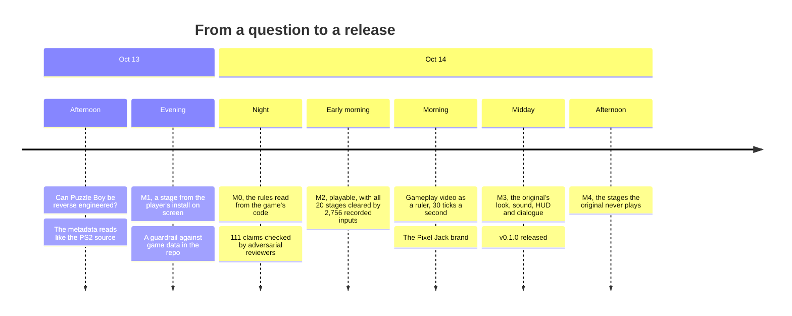

# The journey

> [!TIP]
> **TL;DR:** Two days from "can this even be done?" to a released port. Inside the HD Remaster is the 2003 PS2 minigame, converted to C#, with its original names intact. We read the rules from that code, proved them with 2,756 recorded inputs, measured the timing from gameplay video, and rebuilt the look from the player's own install.

**Read time:** 5 minutes

## Timeline

## The highlights

### A PS2 game in a Unity costume

- The HD Remaster is a Unity 2019.4 game compiled with IL2CPP. Its metadata isn't encrypted, so every class and method name can be read before decompiling anything.
- Those names are the 2003 originals: `pbGame.pushCheck`, `roundCheck` for swivel blocks, and `hallCheck` for holes (yes, "hall"). The `pb_H` namespace is clearly the old `pb.h` header, and the developers' level editor, `pbEdit`, is still in the build.

### Six stage files broken by a line ending

- The stages are 50 small files of exactly 828 bytes, except six that are a few bytes longer.
- Somewhere in the original pipeline, every `0A` byte became `0D 0A`, a Windows line ending, as if the binary files were text. Undo that and they're 828 bytes again, and perfectly sensible.
- The original never loads those six, so nobody noticed. The port's parser repairs them, and this repo's `.gitattributes` marks stage files as binary so it can't happen here.

### The line we drew

- The game's code sits behind Denuvo Anti-Tamper. All 225 Puzzle Boy methods turned out to be in the unprotected part, so one rule was enough: read unprotected code statically and leave the rest alone. [Reverse engineering](reverse-engineering.md) has the details.

### The first board was a mirror image

- The port first drew +y down the screen. AppMedia's recorded solution for stage 1 cleared under exactly one of the 8 possible ways to map screen directions onto the grid, and it wasn't ours.
- Up moves toward +y on screen. Fixing that flipped the board, and the same solutions then cleared all 20 stages.

### The game's clock came from gameplay video

- The original runs one tick per rendered frame, so its speed follows your frame rate. The code can't tell you what "normal" is.
- In 60 fps gameplay video, every move lasts a multiple of 8 frames, and stage 1's five-cell walk lasts exactly 40. That's 4 ticks a step at 30 ticks a second, which is what the port runs. [Timing and camera](timing-and-camera.md) has the rest.

### No font file, so the font is drawn by hand

- The game ships its text only as TextMeshPro distance-field atlases. With no TTF to borrow, the port runs TextMeshPro's shader math on the CPU. See [Rendering and UI](rendering-and-ui.md).

### Some stages could never be finished

- Six of the seven stages with more than one Jack-o'-Lantern can't be won under the original's rules, because nothing lets you switch characters. The port adds a switch. See [Bonus stages](bonus-stages.md).

## By the numbers

| What | How many |
|---|---|
| Puzzle Boy methods in the game | 225, all in unprotected code |
| Stage files | 50, of which the original plays 20 |
| Research claims checked | 111 for the rules, 94 for the presentation |
| Recorded inputs replayed in the port | 2,756 over 20 stages, none refused |
| Fidelity bugs a review found in the first M3 build | 12, all fixed |
| Tests | 164 |
| Release archives | 4 (Windows, Linux, and Apple Silicon and Intel macOS), about 37 MB each |
