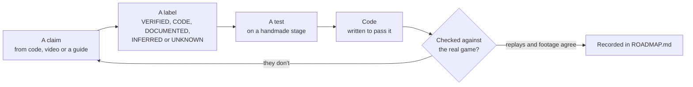
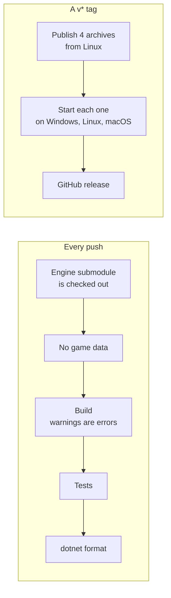

# Keeping it honest

> [!TIP]
> **TL;DR:** Every claim gets a label and a source. Rules are tests before they're code, and recorded solutions from the real game must clear the port. The look is checked against footage. CI fails on game data, warnings, missing docs, failing tests or bad formatting, and every release build has to start on its own OS before it's published.

**Read time:** 4 minutes

## The loop

## Labels

| Label | Means |
|---|---|
| VERIFIED | Seen in the HD game or a video of it, or a recorded solution replayed in the port |
| CODE | Read from the game's code |
| DOCUMENTED | A guide or wiki says so |
| INFERRED | Our best reading, not shown directly |
| UNKNOWN | Nobody knows yet |

## The checks that caught real bugs

- **Adversarial reviewers.** Each research claim was re-read by a second agent whose job was to refute it. One example: the step is 4 ticks, not 5.
- **Mutation checks on the rules.** Breaking any of 9 rules on purpose fails at least one test, among them the swivel's turning direction, the fall, the sweep check, the undo limit and hiding at the goal.
- **Recorded solutions.** AppMedia's 2,756 inputs for the 20 stages all clear the port, each stage exactly on its last input and with nothing refused. They also caught the mirrored board.
- **A fidelity review.** The first M3 build went through a review against the research and footage. It found 12 real differences, from the overhead turn's length to when the next stage loads, and all 12 were fixed.
- **Footage as a ruler.** It gave the tick rate from motion between frames, and the backdrop's framing from image alignment. It also gave edge correlation for every HUD element and a correlation test that picked Jack's idle clip.

## CI and releases

- **No game data:** `scripts/check-no-game-data.sh` fails on Unity bundles, FMOD banks, IL2CPP metadata, Atlus flow scripts, stage files outside the tests, and decompiler output.
- Its positive control, `check-no-game-data.test.sh`, plants each of those in a scratch repo and expects the check to fail. A check for something's absence needs proof that it can fail. Every scratch repo also holds a submodule, which the check must skip, since the engine repo runs the same check on its own files.
- **The engine is a pinned submodule.** CI checks out `external/puzzle-boy-engine` at the pinned commit and stops with a clear message if it's missing, rather than failing later in restore. It comes from GitHub; to try unpushed engine work, a local clone can point the submodule at a local engine checkout.
- **The original's scope.** Tests prove the game loads only the original's 20 stage files, never references `Board.Switch` (a scan of its metadata, with `Board.Step` as the positive control) and has no switch or stage-skip key in its table of pressed keys or its direction table.
- **Docs are part of the build.** Every public type and member needs an XML doc comment, or the build fails (CS1591).
- **Releases** are self-contained, so players don't need .NET. CI has no game install, so each archive must start on its own OS and reach the "there's no game here" message before the release is created.

## What's still unconfirmed

- Nobody has played a macOS build yet. It starts in CI, and that's all we know.
- The help page and the quit question's choice box were never seen in footage. They come from the prefab files.
- The in-game checks for controls are answered from code and recorded solutions, not yet from playing the real game.

## Where to look

- [ROADMAP.md](../ROADMAP.md): every decision and finding, with its label and evidence.
- `.github/workflows/ci.yml` and `release.yml`.
- `scripts/check-no-game-data.sh` and its test.
