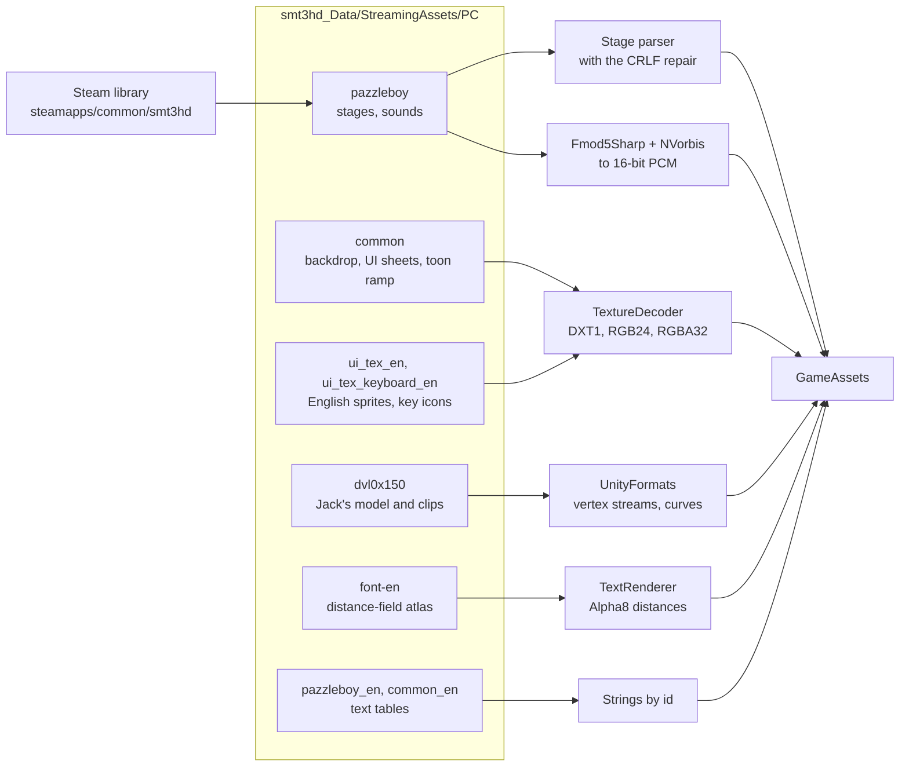

# Reading the game

> [!TIP]
> **TL;DR:** The port finds your Steam install, opens the game's Unity bundles with AssetsTools.NET, and decodes everything itself: stage files, DXT1 textures, FMOD Vorbis audio, Jack's skinned model and animation curves, the text tables and a distance-field font. It all happens once at startup, in about 2 seconds, and nothing is ever written back.

**Read time:** 5 minutes · **Code:** `GameAssets.cs`, and `GameInstall*.cs`, `TextureDecoder.cs` and `UnityFormats.cs` in the engine's `PuzzleBoy.Nocturne`

## From your install to the screen

## Finding the install

- **Beside the executable** comes first: a `smt3hd_Data` folder next to `PuzzleBoy`. It needs only the eight bundles the port reads (`pazzleboy`, `pazzleboy_en`, `common`, `common_en`, `ui_tex_en`, `ui_tex_keyboard_en`, `dvl0x150` and `font-en`, about 115 MB) in `smt3hd_Data/StreamingAssets/PC`, so the game can be uninstalled.
- **Windows:** Steam's path from the registry, then `Program Files (x86)/Steam`.
- **macOS:** `~/Library/Application Support/Steam`.
- **Linux:** `~/.local/share/Steam`, `~/.steam/steam`, and the Flatpak location.
- Every extra library listed in `libraryfolders.vdf` is searched too. If the game is elsewhere, pass the folder that holds `smt3hd.exe` as the first argument.

## Bundles

- The bundles are UnityFS files compressed with LZ4HC. AssetsTools.NET reads them using their type trees, so no Unity install is needed.
- One bundle session can read several assets, such as all the textures a sheet needs.

## Stages

- They're 50 TextAssets of 828 bytes each. Six are damaged by a line-ending conversion, and the parser repairs them. See [Rules](rules.md) for the format.

## Textures

| Format | Used for | How |
|---|---|---|
| DXT1 | The board atlas `sample1` | Decoded on the CPU |
| RGB24 | The backdrop `BG_pzl` | Expanded to RGBA |
| RGBA32 | UI sheets, key icons, the dialogue window | Used as is |
| Alpha8 | The font's distance field | Kept raw for the text renderer |

> [!NOTE]
> Unity stores texture rows bottom-up. The port keeps them that way on the GPU and flips at draw time: Unity UVs for the board, and `FlipVertically` for sprites, whose rectangles are in Unity's bottom-left coordinates.

## Sound

- The effects and music are FMOD FSB5 banks with Vorbis inside. Fmod5Sharp rebuilds each Ogg Vorbis stream, and NVorbis decodes it to 16-bit PCM for MonoGame.
- The effects are `JYAKYO02_SE00` to `SE09`, and the music is `JYAKYO02_BGM00_L_`, where `_L_` marks a loop.
- **Gotcha:** Fmod5Sharp pulled in `Microsoft.Bcl.Memory` 9.0.0, which has a known vulnerability (NU1903). Central package management pins the patched 9.0.20 for transitive packages too.

## Jack-o'-Lantern

- The prefab `devil_0x150` lives in `dvl0x150`. It holds two skinned meshes with 24 and 8 bones, a lantern on the hand bone, eye quads, a shadow quad, and 8 Mecanim clips sampled at 30 a second.
- **Meshes** use Unity 2019's vertex streams, decoded by `UnityFormats`.
- **Animation clips** are Unity's "streamed" curves: Hermite cubic keys, parsed by hand. The idle is clip `b00`, and it loops every 80 ticks.
- **Gotcha:** Unity's bind poses are stored for column vectors and XNA math uses row vectors, so each bind pose is transposed. Skipping that turns Jack into a tangle.
- He's skinned on the CPU every tick. See [Rendering and UI](rendering-and-ui.md).

## Text and the font

- The string tables are `PBMESSAGE_EN` and `PUZZLEBOY_EN` in `pazzleboy_en`, and `GUIDE_EN` in `common_en`, which has the controls bar labels.
- Strings carry `<COLOR n>` tags, which pick one of the font's materials.
- The only font is a TextMeshPro distance-field atlas plus its materials, from `font-en`. There's no TTF or OTF anywhere in the game.

## Where to look

- `GameInstall.cs` (engine, `PuzzleBoy.Nocturne`): finding the install, opening bundles, textures and sounds.
- `GameInstall.Character.cs` and `GameInstall.Text.cs` (engine, `PuzzleBoy.Nocturne`): Jack, the text and the font.
- `GameAssets.Read`: everything read at startup, in one place.
