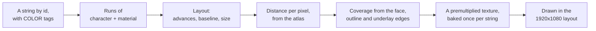

# Rendering and UI

> [!TIP]
> **TL;DR:** The board is unlit, textured from the game's own atlas, with see-through glass walls and a glowing goal. Jack is skinned on the CPU and toon-shaded. The HUD keeps the original's 1920×1080 layout at any window size, and all text goes through a TextMeshPro distance-field renderer written for the CPU. The finer numbers were checked against gameplay footage.

**Read time:** 5 minutes · **Code:** `Hud.cs`, `TextRenderer.cs`, `BoardView.cs`, `CharacterModel.cs` and `CharacterView.cs` in the engine's `PuzzleBoy.Rendering`

## Coordinates

- The original measures a cell as 40 units, and cell (x, y) sits at (40x − 380, 40y − 380).
- The port uses 1 unit per cell, with world position (x, height, −y). The default view shows +y going up the screen.

## The board

- **Unlit.** The original sets no normals, and footage confirms that the floor matches the atlas texel within 2 levels.
- **Blocks and swivels** are cubes textured from the `sample1` atlas, with white outlines along each group's outer top edges. The code's numbers suggested the bottom edges, but footage showed the top.
- **Walls** have no top. Each side facing the play area is a floor-height band plus a glass band at 20% opacity, with a grey outline.
- **The goal** is an untextured cube spinning 1° a tick. Its color is written as 255, so at 30% opacity it saturates toward cyan, which is why it glows.
- **The backdrop** `BG_pzl` shows 1.55× larger than a plain 16:9 fit, centered on image pixel (960, 372). Those numbers came from aligning the image with a footage frame using FFT cross-correlation, after a brute-force search was too slow (correlation 0.95).

## Jack-o'-Lantern

- **Posing.** Every tick, the idle clip is sampled, the bones are composed, and the meshes are skinned on the CPU.
- **Toon shading.** `DualTextureEffect` multiplies the texture by a ramp from the `tone2` texture, lit from screen-left. That fit to footage is INFERRED; the real shader is asset data.
- **The shadow** is a quad drawn with reverse-subtract blending, taking away about 80% of its texture. **The lantern's glow** is added around its hook point, `h_fire`.
- **Facing.** He faces the last direction pressed (yaw 90° × direction), even when the step is refused. Before the first input he faces the camera.

## The HUD

- Everything is laid out on the original's 1920×1080 canvas, then scaled by `min(width / 1920, height / 1080)` and centered.
- The sprites come from the game's sheets: the stage counter and its digits, COMPLETE!, UNDO with its rewind mark, the scroll arrows, and the controls bar with keyboard icons.
- Three blends: alpha for plain sprites, additive for glows, premultiplied for text.

## Text, drawn on the CPU

The game has no font file, only TextMeshPro's distance-field atlas, so the port does TextMeshPro's job itself:

- The edges come from each material's settings, such as face dilation, outline width and underlay offset, the same way TextMeshPro's shader computes them.
- One fitted number: the face edge is moved by +0.035, which matches the footage's text weight better than the exact value. It's marked as a `shortcut:` in the code.

## Dialogue, menu and help

- **Dialogue:** the Manikin Kid's window types one character a tick, and the advance icon appears a tick after the last character. After the last page, the name fades over 2 ticks and the window over 7.
- **Menu (□, F):** Undo, Restart, Help and Quit. The cursor wraps, and a held key repeats on the first tick, then every 2nd tick after 7. Undo keeps the menu open, as it does in the footage.
- **Help:** one panel of rules and obstacles, built from the prefab files. No video shows it, so its look is unverified.
- **Quit:** a question with two choices. The cursor starts on "keep trying", and cancel picks it too.

## How we know it looks right

- Each UI element was drawn at the spec's numbers and compared with footage frames by edge correlation. The scores ran from 0.94 to 0.996, with no shift needed.
- Jack's idle correlates 0.65 with the footage's loops, and every other clip, facing and mirror scores 0.16 or less.
- Where nothing could be checked, the code or ROADMAP says so: INFERRED or UNKNOWN.

## Where to look

- `BoardView`: board geometry, outlines, glass, the goal and the backdrop.
- `CharacterModel` and `CharacterView`: pose, skinning, shading, the shadow and the glow.
- `Hud`: every sprite and layout number. `TextRenderer` handles the fonts.
