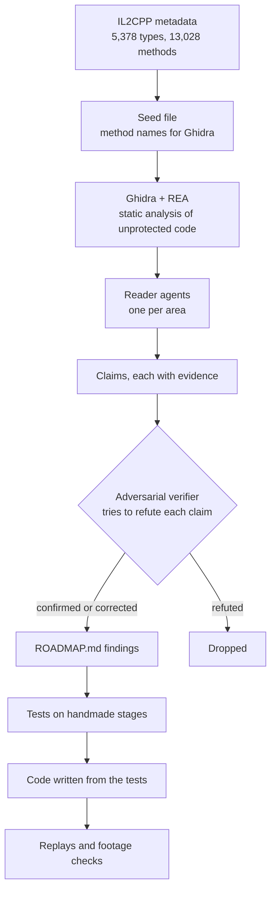

# Reverse engineering

> [!TIP]
> **TL;DR:** The game's metadata gave us every class and method name. A small script turned those names into labels for Ghidra, REA read the functions, and an adversarial reviewer re-checked every claim. Nothing here runs, dumps, de-obfuscates or patches the protected code. Where the code couldn't answer, gameplay video and published solutions did.

**Read time:** 5 minutes

## The pipeline

## The line we drew

| We did | We didn't |
|---|---|
| Read the unprotected code statically | Run the game under a debugger or dump its memory |
| Check that every Puzzle Boy method lives there (225 of 225) | De-obfuscate or analyze the protected code |
| Answer what the code couldn't with video and guides | Patch or mod the game |

If a question had led into protected code, the rule was to stop and answer it by playing the real game instead. AGENTS.md makes all of this a hard rule.

## Why the metadata was the key

- IL2CPP compiles a Unity game's C# into native code, but it keeps a metadata file with every name. Here that file isn't encrypted.
- Il2CppDumper, the usual tool, failed on this build for two reasons:
  - the protector renamed the sections that hold IL2CPP's registration tables;
  - the tables use a newer layout (v24.3) than the metadata reports (v24.2).
- So we found the tables by hand. A short script maps each method name to its code, and REA's seed file passes those names to Ghidra. That's how `pbGame.pushCheck` shows up in Ghidra under its own name.

## How a claim becomes a rule

1. A reader agent studies one area, for example pushing, and writes claims such as "a block never pushes another block", each with evidence.
2. A verifier re-reads the same functions and tries to prove each claim wrong.
3. Only confirmed or corrected claims reach ROADMAP's findings, with short evidence IDs. The pseudocode itself never leaves `re/`.
4. Each rule becomes a test drawn as a handmade stage, and the code is written to pass it. Nothing is pasted or translated from the decompiler.

| Round | Readers | Claims checked | Confirmed as written |
|---|---|---|---|
| M0, the rules | 7 | 111 | 97 |
| M3, the presentation | 4 | 94 | 66 |

The rest were corrected, refuted or left uncertain. Corrected claims are recorded in their corrected form, and refuted ones are dropped.

The reviewers earned their keep. For example, they caught that a step takes 4 ticks, not 5.

## When the code couldn't answer

- **Speed.** The original's pace follows the frame rate, so the tick rate was measured from 60 fps gameplay video.
- **Looks.** Materials are asset data, so colors, outline placement and the backdrop's framing were checked against footage. The outlines run along the top edges, not the bottom edges the code's numbers suggested.
- **Controls.** AppMedia's recorded solutions clear the stages under only one key mapping, which settled which way is up.
- **Labels.** Every finding carries one: VERIFIED (seen in play or replayed), CODE, DOCUMENTED (a guide says so), INFERRED or UNKNOWN.

## Tools

- **REA** with **Ghidra 12.1** and JDK 21, for the native code.
- **AssetsTools.NET** for Unity bundles, which REA can't open.
- **ffmpeg** and small scripts for measuring footage: motion between frames, image alignment and edge correlation.
- The full Ghidra analysis of the 383 MB `GameAssembly.dll` needs most of a 32 GB machine. It runs once, and later sessions open a saved snapshot.

## What stays local

`re/` is git-ignored. Decompiled functions, notes, method tables and footage measurements live there. The repo only gets the conclusions and the tests built from them.
