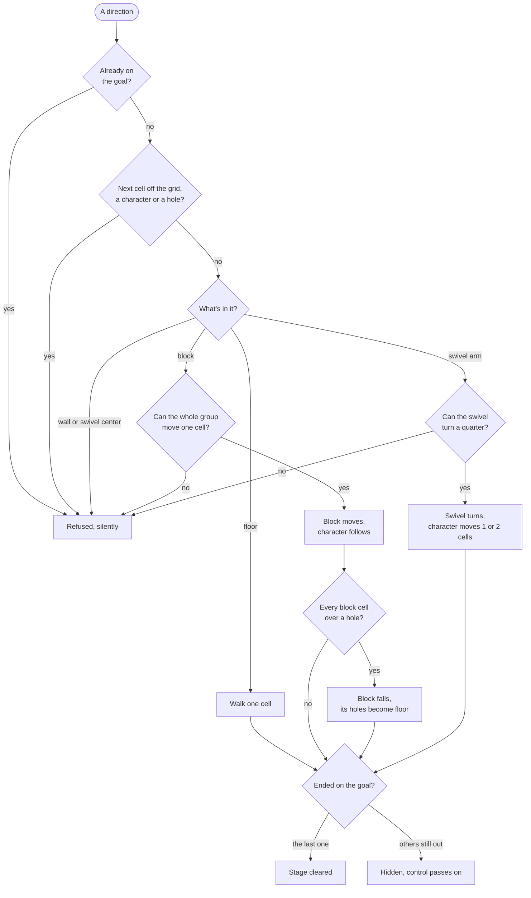

# Rules

> [!TIP]
> **TL;DR:** A stage is an 828-byte file with a 20×20 grid. Each move is checked in a fixed order: the goal, then bumps, then whatever is in the next cell. Blocks move one cell as a group, fall when every cell is over a hole, and never push other blocks. Swivels turn a quarter. Undo remembers the last 30 pushes and turns, and plain walking is never recorded.

**Read time:** 5 minutes · **Code:** `PuzzleBoy.Rules`, in the engine submodule `external/puzzle-boy-engine`

## The stage file

| Bytes | What |
|---|---|
| 0–3 | Character count, int32 (1 to 4) |
| 4–7 | One enable byte per slot. These, not the count, pick the characters |
| 8–23 | Four start positions, int16 x and y each |
| 24–27 | The goal, int16 x and y |
| 28–827 | 400 cells, uint16 little-endian; cell (x, y) is number 20 × y + x |

The bundle names them `pbMap00.map` to `pbMap49.map`. Six shipped with every `0A` byte turned into `0D 0A`, and `Stage.Parse` undoes that for any file longer than 828 bytes.

## Cells

| Value in the file | Meaning |
|---|---|
| `0x0000` | Floor |
| `0x2000` | Wall |
| `0x0800` | Hole |
| `0x60nn` | Block cell of group `nn` |
| `0x80nn` | Swivel center of group `nn` |
| `0xA0nn` | Swivel arm of group `nn` |

Bits 13 to 15 are the type, `0x0800` is the hole flag, and the low 11 bits are the group. A group is every cell with the same id, even cells that don't touch.

## One step



## Pushing and holes

- Only the group you walk into moves, one cell. Every cell must land on the grid, on floor or on its own group's cells, with no character there.
- A wall, another block or a swivel refuses the push, so **a block never pushes another block**.
- Holes and the goal don't stop a push. A block falls only when every one of its cells is over a hole. The fall fills those holes with floor, and the block is gone.
- A block or arm cell sitting on a hole can't be stepped into, because the hole check comes first.

## Swivel blocks

- Pushing an arm turns the swivel exactly a quarter turn. The arm you pushed ends up on the side of the center you pushed toward.
- The turn is refused when:
  - you're in line with the center (the same row or column);
  - your path crosses a hole or a wall;
  - any swivel cell would land on, or sweep through, a wall, another group or another character. The swept cell is the center plus the old offset plus the new one.
- Holes and the goal never block a turn, and an arm can stop over a hole without filling it.
- You move 2 cells when the cell beside you, across the push, belongs to the same swivel, and 1 cell otherwise.

## Characters, the goal and the switch

- A character that reaches the goal while others are still out is hidden, and control passes to the next visible slot, in ascending order.
- The last one to arrive clears the stage. Input locks, the undo history is wiped, and the next stage loads.
- **The switch is the engine's addition, and this port doesn't use it.** The original only passes control on a goal arrival. `Board.Switch` passes it the same way at any time, so Community Edition can finish the unused multi-character stages. This port, like the original, has no switch key. See [Bonus stages](bonus-stages.md).

## Undo and retry

- Only pushes and swivel turns are recorded, and a push counts as one action together with its fall. Undo goes back to just before the last one and drops any walking since.
- Hidden characters reappear, filled holes reopen, and control returns to whoever made that push or turn.
- The last 30 actions are kept, the 31st overwrites the oldest, and there's no redo. Retry restores the file layout and wipes the history.

## Where the port differs, on purpose

None of these can show up in a stage the original plays.

| The original | The port | Why |
|---|---|---|
| Checks for another character at (y, x), with x and y swapped | Checks the real cell | The bonus stages' results are the same either way |
| The two-cell swivel step compares group ids only | Counts only the swivel's own cells | Avoids matching floor if a swivel used group 0 |
| A swivel turn past the grid's edge would crash | Refuses the turn | No shipped swivel touches the edge |
| Undo stores only what changed | Undo stores a full copy | Simpler, with the same results |
| No way to switch characters | The engine has `Board.Switch`; this port never calls it | Community Edition's multi-character stages need it |

## Rules as drawings

Tests draw stages as text: `#` wall, `.` floor, `o` hole, `G` goal, `1`–`4` characters, lowercase letters for block groups, and `C`/`R` for a swivel's center and arms. Columns are x and rows are y, going down the drawing. The game shows +y going up the screen, so the board on screen is this drawing upside down.

```text
#2##
1a..
#o##
#G##
```

Only character 2 can push `a` down into the hole, and character 1 can't get to that cell while 2 is standing in it. Without the switch, this stage can't be finished. With it, 2 pushes, walks home, and then 1 follows. That's the test `A_switch_lets_the_waiting_character_make_the_push_only_it_can_reach`.

## Where to look

All in the engine submodule, `external/puzzle-boy-engine`:

- `src/PuzzleBoy.Rules/Stage.cs`, `Cell` and `CellKind`: the file format.
- `src/PuzzleBoy.Rules/Board.cs`: every rule above.
- `tests/PuzzleBoy.Rules.Tests/*Tests.cs`: one drawing per rule. `Ascii.cs` explains the legend.
