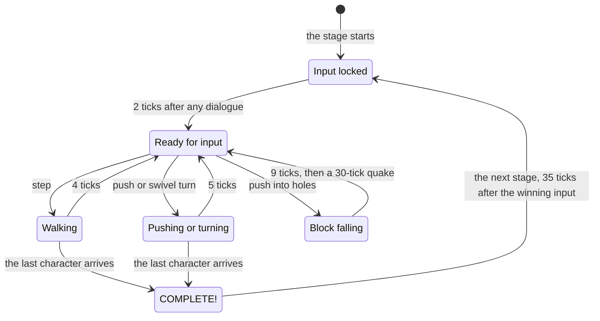

# Timing and camera

> [!TIP]
> **TL;DR:** The port runs at the original's 30 ticks a second, measured from gameplay video. A step takes 4 ticks, a push or a turn 5, and a fall 9. Input is read once per tick in a fixed order, and never while a move plays. The camera follows Jack, turns 90° at a time, and keys always follow the view.

**Read time:** 4 minutes · **Code:** `PuzzleBoyGame.cs`, `ViewCamera.cs`, `MoveAnimation.cs`

## Where 30 ticks a second comes from

- The original runs one tick per rendered frame, so its speed follows the frame-rate setting and the display. On a 144 Hz screen it plays faster.
- The code can't say what "normal" is, so we measured it. In 60 fps gameplay video, every move lasts a multiple of 8 frames, and stage 1's five-cell walk lasts exactly 40 frames.
- 40 frames at 60 fps for 5 steps is 4 ticks a step at **30 ticks a second**. Even the extra tick after a swivel turn shows up as a 2-frame pause.

## A move's life

| What | Ticks |
|---|---|
| A step | 4. The next input is read on the 4th tick, so holding a direction walks without pauses |
| A push or a swivel turn | 5 (a swivel turns 22.5° a tick) |
| A push that falls | 9: it slides for 4, sinks for 4, then one more |
| The camera quake after a fall | 30 |
| Input lock at a stage start or restart | 2 |
| COMPLETE! | Shows for 30, and the next stage loads 35 after the winning input |
| The UNDO banner | 30 |
| Dialogue typing | 1 character a tick |

> [!IMPORTANT]
> The original reads **no input at all** while a move plays. A press made then is lost, not queued. Holding works because the key is still down on the tick the move ends.

## Input order within a tick

1. △, toggle scroll (Tab)
2. ○, overhead view (V)
3. The directions: up, down, left, right. The first one held wins.
4. L1 and R1, turning the view (Q and E)
5. The port's own keys: switch (C), then □ for the menu (F)

## The camera

| | Normal view | Overhead view |
|---|---|---|
| Pitch | 60° | 90° |
| Position | 10 cells up and 6 back from Jack | 11.25 cells straight up |
| A quarter turn | 9 ticks of 10° | 12 ticks, snapping to the exact angle on the last |
| Field of view | 60° | 60° |

- The camera aims a quarter cell below Jack, because the original orbits its model object, which sits a little lower than the character's position.
- In the normal view, a turn orbits the point where it started, even if Jack walks during it. Directions still work mid-turn, but L1, R1, ○ and □ wait for it to end.
- ○ switches views over 3 steps, plus 1 busy tick.
- The view's turn and angle carry over between stages, as in the original.

## Keys follow the view

- Screen directions are numbered 0 up, 1 right, 2 down and 3 left. Grid directions are numbered 0 for +y, 1 for +x, 2 for −y and 3 for −x.
- The rule is **grid direction = (screen direction − view turn) mod 4**. Turn the view, and every key turns with it.
- On the default view, Up moves toward +y. The port first got this upside down, and AppMedia's recorded solutions caught it: only the correct mapping clears every stage.

## Where to look

- `PuzzleBoyGame.Update` and `Play`: the input order, the locks and the stage flow.
- `ViewCamera`: the turns, the views and the quake.
- `MoveAnimation`: how long each move lasts and when the sounds fire.
- `tests/PuzzleBoy.Tests/TimingTests.cs` and `ControlsTests.cs`.
